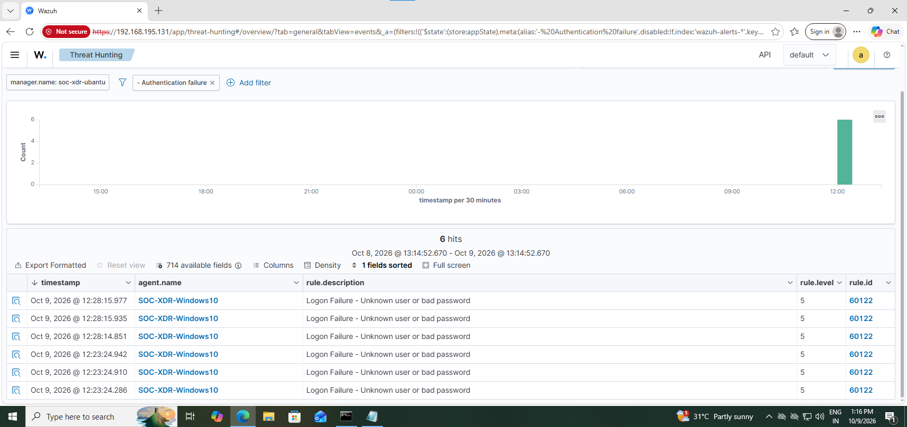
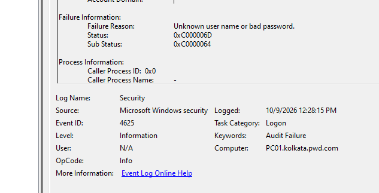
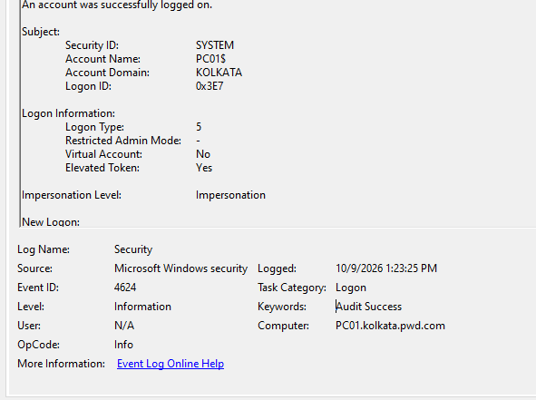

# SOC-XDR-Ubuntu-Home-Lab
Hands-on SOC lab using Wazuh SIEM, Ubuntu Server and Windows 10
SOC-XDR Ubuntu Home Lab — SIEM Monitoring and Alert Investigation

1. Project Overview

This project is a hands-on Security Operations Center (SOC) home lab built to practice security event monitoring, alert triage, log analysis, and basic incident investigation.

The lab uses Ubuntu Server as the SIEM server, Wazuh for security monitoring, Windows 10 as a monitored endpoint, and VMware for virtualization.

2. Project Objectives

- Set up a Wazuh SIEM monitoring environment.
- Connect a Windows endpoint to Wazuh.
- Monitor security events and authentication failures.
- Investigate alerts using Windows event logs and Wazuh rule details.
- Develop practical skills relevant to an entry-level SOC Analyst role.

3. Tools and Technologies

- SIEM: Wazuh 4.14.7
- Server OS: Ubuntu Server 24.04.5 LTS
- Endpoint OS: Windows 10 Pro
- Virtualization: VMware
- Log source: Windows Security Event Logs

4. Lab Architecture

The lab consists of an Ubuntu Server virtual machine running Wazuh and a Windows 10 virtual machine monitored through the Wazuh agent.

Event flow:

Windows 10 endpoint → Wazuh agent → Wazuh server → Wazuh dashboard → Alert investigation

5. Implementation

1. Created virtual machines in VMware for Ubuntu Server and Windows 10.
2. Installed and configured Wazuh on the Ubuntu Server virtual machine.
3. Accessed the Wazuh dashboard.
4. Connected the Windows 10 endpoint to the monitoring environment.
5. Reviewed authentication-failure alerts in the Wazuh dashboard.
6. Examined alert details, Windows event IDs, rule IDs, and failure status codes.

6. Investigation 1: Authentication Failures

Objective: Understand and investigate unsuccessful Windows login attempts recorded by the monitoring system.

Evidence examined:

- Wazuh rule ID: "60122"
- Windows Event ID: "4625"
- Event category: Failed logon
- Status code observed: "0xC000006D"
- Substatus code observed: "0xC0000064"

Investigation approach:

1. Opened the Wazuh dashboard and reviewed authentication-failure alerts.
2. Examined the alert details and associated Windows security event.
3. Reviewed the event and failure status codes to understand the unsuccessful login.
4. Used the event information to identify what additional details would be relevant when investigating a failed authentication.

Finding: The recorded events indicated unsuccessful authentication attempts. The status and substatus codes provided additional context for understanding the login failure.

A failed login does not automatically mean an attack occurred. The source, frequency, account involved, and surrounding events should be reviewed before deciding whether activity is suspicious.

7. Skills Practiced

- SIEM monitoring with Wazuh
- Security alert triage
- Windows Security Event Log analysis
- Authentication-failure investigation
- Basic incident investigation
- Virtual machine and lab environment management

8. Current Status and Future Improvements

The initial authentication-failure investigation has been completed. Future improvements may include investigating additional Windows security events, comparing normal and suspicious login patterns, creating documented investigation playbooks, and practicing further alert-triage scenarios.

9. Project Evidences
 
### Wazuh SIEM - Failed Logon Alert
Captured authentication failures (`Rule ID: 60122`) mapped from Windows endpoints to the Wazuh manager dashboard.

### Windows Event ID 4625: Failed Logon
Local security audit log showing a failed logon attempt due to an unknown username or bad password (`Status: 0xC000006D`).

### Windows Event ID 4624: Successful Service Logon
Verification of a successful service logon (`Logon Type: 5`) under SYSTEM privileges for baseline comparison.

11. Disclaimer

This is a personal educational lab conducted in a controlled virtual environment. The project is intended for cybersecurity learning and defensive security practice.
